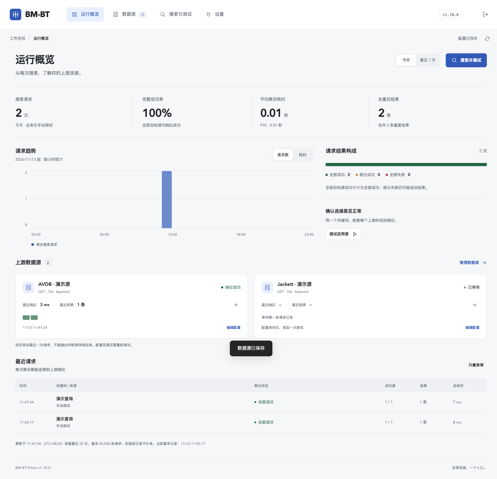

# BM-BT-Proxy

将多个 BT 搜索源接入 Byte-Muse 的同一个 `BT_URL`，并在 Web 控制台管理连接、排查失败和调整结果顺序。

[](https://hub.docker.com/r/violin321/bm-bt-proxy)
[](https://github.com/violin321/bm-bt-proxy/actions/workflows/docker-publish.yml)

- **多源聚合**：并发请求 GET / POST 源，按磁链、ED2K 等标识去重；保留各源耗时、错误和部分成功状态。
- **数据源管理**：支持通用 HTTP 接口、原生 Jackett，以及独立部署的 DB Online 适配器。每源可配置请求头、超时和去重优先级。
- **运行概览**：查看业务查询与手动测试的趋势、最近源响应和请求详情；状态代表最近一次请求。
- **搜索结果排序**：将资源属性、源分类、磁链标签和影片风格加入同一排序队列；默认关闭，保存后生效。
- **目录登录**：AVDB / 修仙兼容源可用账号密码取得目录会话，支持 AVDB 二次验证码；保留高级 Cookie / Authorization 方式。仅保存已校验的会话，账号密码和验证码不落盘。
- **LTX 优选**：独立接口优先返回带明确 LTX 标记的无码资源，保留其他无码候选供 Byte-Muse 筛选后兜底。



*截图使用隔离合成源及测试数据。*

项目边界与数据流见 [项目概览](docs/OVERVIEW.md)，已发布版本见 [Releases](https://github.com/violin321/bm-bt-proxy/releases)。

## Docker 部署

镜像支持 `linux/amd64` 和 `linux/arm64`。创建 `compose.yml`：

```yaml
services:
  bm-bt-proxy:
    image: violin321/bm-bt-proxy:1.10.0
    container_name: bm-bt-proxy
    restart: unless-stopped
    ports:
      - "8000:8000"
    volumes:
      - ./bm-bt-data:/data
    environment:
      TZ: Asia/Shanghai
      WEB_USERNAME: "${BM_WEB_USERNAME:?请设置管理账号}"
      WEB_PASSWORD: "${BM_WEB_PASSWORD:?请设置管理密码}"
      SECRET_KEY: "${BM_SECRET_KEY:?请设置固定随机签名密钥}"
```

在同目录 `.env` 填写自己的值：

```dotenv
BM_WEB_USERNAME=your-admin
BM_WEB_PASSWORD=replace-with-your-password
BM_SECRET_KEY=replace-with-a-long-random-value
```

运行 `docker compose up -d`，打开 `http://服务器地址:8000` 并登录。在“数据源”添加真实源地址，再到“搜索与测试”检查响应。外网使用时通过 HTTPS 反向代理访问。

管理登录需同时设置 `WEB_USERNAME`、`WEB_PASSWORD`；缺少任一项时控制台不要求登录。`SECRET_KEY` 应固定保存，避免升级后已有登录会话失效。管理登录和下游聚合接口的 API Key 分别配置。

`/data` 保存配置、认证会话、请求历史与标签缓存，应持久化并纳入私有备份。新部署可通过 `BT_SOURCE_1_URL`、`BT_SOURCE_1_METHOD`、`BT_SOURCE_1_HEADERS`、`BT_SOURCE_1_FIELD`、`BT_SOURCE_1_TIMEOUT` 等环境变量初始化数据源；已有 `config.json` 优先，日常修改通过控制台完成。

## 连接 Byte-Muse

在“设置 → 连接 Byte-Muse”选择可从 Byte-Muse 容器访问的地址和接入方案，复制生成的配置到 **Byte-Muse 服务的 `environment`**，再重建该服务。两个容器处于同一 Docker 网络时，标准配置为：

```yaml
BT_URL: "http://bm-bt-proxy:8000/api/torrents"
BT_METHOD: "get"
BT_HEADER: "{}"
BT_JSON_DATA: ""
```

如果开启“聚合接口保护”，使用页面生成的 `BT_HEADER`，其中包含实际 `X-API-Key`。页面默认遮挡密钥，主动复制时才带入。若 Byte-Muse 已保存过 BT 配置，需在其管理页核对实际生效值。

**LTX 优选**选择 `/api/torrents/ltx`，同时在 Byte-Muse 将默认排序设为 `uc`，保留“仅无码”及既有大小、清晰度等筛选。希望全部候选不合格时停止，使用 Byte-Muse 严格模式。LTX 标记来自上游标签／标题，不验证实际破解模型；完整边界见 [LTX 接入说明](docs/LTX-PREFERRED-20261108.md)。

## 控制台使用

| 页面 | 用途 |
| --- | --- |
| 运行概览 | 今天／最近 7 天统计、请求趋势、源响应历史、异常筛选及请求详情 |
| 数据源 | 添加／编辑／启停源、配置搜索请求头、Jackett 站点和目录登录 |
| 搜索与测试 | 单源或全源查询，查看去重结果、原始 JSON、上游标签及排序依据 |
| 设置 | 生成 Byte-Muse 配置、保护聚合接口、编辑搜索结果排序、查看运行版本和构建编号 |

**排序的两个步骤**：先在“从上游分类与标签中添加规则”选择候选项，再回到“当前排序规则”调整方向和顺序并保存。同步目录只更新候选项，不自动改变排序。

目录读取与搜索分开认证。AVDB / 修仙兼容源选择“账号密码登录”后，保存时登录并验证目录读取权限；会话过期后重新登录。Jackett 使用其 API Key；其他协议可用高级请求头。目录可能仅覆盖当前源数据库、站点声明分类或 DB Online 已缓存影片，不能视为全站标签全集。影片风格由同片磁链共享，不等于单条资源的无码、字幕或清晰度属性。

## 接口

| 接口 | 行为 |
| --- | --- |
| `GET /api/torrents?keyword=...` / `POST /api/torrents` | 标准聚合，响应 `{ "data": [...] }` |
| `GET/POST /bt/api` | 标准接口兼容别名 |
| `GET/POST /api/torrents/ltx` / `GET/POST /bt/api/ltx` | LTX 优选，仅保留严格 `uc=true` 的资源 |
| `GET /api/version` | 当前服务版本与构建提交，需要控制台认证（如已启用） |
| `/openapi.json` | FastAPI 接口描述 |

启用接口保护后，搜索请求携带 `X-API-Key`，也兼容 `?token=...`。POST 可使用 `keyword` / `q` / `wd`；完整参数见 OpenAPI。管理接口沿用控制台登录认证。

## 升级与维护

升级前备份整个 `/data` 和部署配置，保留旧镜像。优先使用固定版本或摘要；`latest` 会随 `main` 构建变化。仅凭版本号不能判定镜像完全一致，需同时比较镜像摘要和 `/api/version` 的构建编号。

更新镜像后，检查容器健康、原登录、实际源查询与历史保留。健康检查只说明 Web 服务能响应；上游可用性需实际查询确认。请求历史保留最近 30 天、最多 50,000 条，记录关键词、源响应与数量，不保存请求头或响应正文。

```bash
docker compose pull bm-bt-proxy
docker compose up -d --no-deps bm-bt-proxy
```

本地开发与验证：

```bash
python -m venv .venv
.venv/bin/pip install -r requirements.txt
DATA_DIR=./local-data WEB_USERNAME=admin WEB_PASSWORD=your-password \
  .venv/bin/uvicorn app.main:app --host 127.0.0.1 --port 8000
```

后端契约位于 `frontend-verification/*contracts.py`，从仓库根目录使用 `PYTHONPATH=. .venv/bin/python 文件路径` 运行。浏览器验收需先启动隔离预览并使用测试凭据，不指向生产数据目录。

## 专项说明

- [Docker Hub Overview](docs/DOCKERHUB.md)（由 GitHub Actions 同步至镜像页）
- [项目架构与边界](docs/OVERVIEW.md)
- [目录登录、设置整理与镜像核对](docs/CLOSEOUT-20261113.md)
- [Jackett 与源优先级](docs/JACKETT-20261107.md)
- [目录范围、缓存与权限](docs/RESOURCE-DIRECTORIES-20261107.md)
- [DB Online 部署](deploy/db-online/README.md) · [影片风格](docs/DBONLINE-GENRES-20261107.md) · [无匹配误报修复](docs/DBONLINE-NOT-FOUND-20261108.md)
- [LTX 方案、消费端筛选与验证](docs/LTX-PREFERRED-20261108.md)

验收文档记录对应时间与范围，不代表源站持续在线，也不代表已完成实际下载或物理手机验收。
