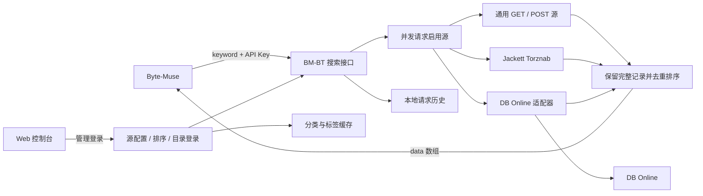

# 项目概览

BM-BT-Proxy 为 Byte-Muse 提供一个稳定的 BT 搜索入口，将多个源的结果转换、聚合、去重并返回。项目包含控制台和 FastAPI 服务；DB Online 适配器作为可选独立服务部署。

## 数据流

## 功能分工

| 层 | 负责什么 | 关键边界 |
| --- | --- | --- |
| 搜索源 | 提供原始资源、属性、标签和可选目录 | BM-BT 不保证源站持续可用，也不补造资源属性 |
| BM-BT | 并发查询、协议转换、去重、返回顺序、响应诊断 | 部分源失败时仍可能返回其他源结果；公开接口只返回资源数组 |
| Byte-Muse | 下载条件筛选、订阅模式、最终排序和下载 | 可再次改变 BM-BT 的顺序；LTX 方案需按说明设置消费端 |
| 目录缓存 | 为排序提供可选分类／标签 | 目录项不会被注入搜索结果，不等于全库资源清单 |
| 管理控制台 | 源管理、手动测试、统计和连接配置 | 源状态来自最近完成的请求，无后台在线监控承诺 |

标准接口按源优先级选择重复资源的完整胜出记录，再执行已保存的排序规则。LTX 专用接口先筛选明确 `uc=true` 的资源，并优先选择有资源级 LTX 标记的重复记录及返回顺序。两种方案均不拼接不同资源的属性，也不因缺少标签删除普通候选。

## 认证与保存

- **管理登录**：`WEB_USERNAME` / `WEB_PASSWORD` 与固定 `SECRET_KEY` 决定控制台登录会话。
- **下游 API Key**：保护 Byte-Muse 等程序调用的搜索接口，在设置页启用。
- **搜索源认证**：每源搜索请求头或 Jackett API Key，独立于下游 API Key。
- **目录认证**：默认继承搜索请求头；账号密码登录将已校验的 Bearer 会话存入目录专用请求头。账号、密码、二次验证码仅在本次保存请求中使用，不保存。目录会话过期需手动重新登录。

配置和凭据会话以明文保存在私有 `/data/config.json`，需要限制主机文件和备份的访问权限。目录认证及 Jackett 密钥在管理响应中仅显示是否已保存，不回显原值。账号密码登录不提供任意登录 URL，接口由当前源地址的兼容路径生成，不跟随跳转，不自动重试密码。

## 代码入口

| 文件 | 职责 |
| --- | --- |
| `app/main.py` | Web/API 路由、管理认证、配置变更和查询编排 |
| `app/config.py` | 配置校验、兼容加载和原子保存 |
| `app/providers.py` | 通用源与 Jackett 请求／转换 |
| `app/aggregation.py` / `app/ltx.py` | 去重、稳定排序与 LTX 方案 |
| `app/catalog_auth.py` | 兼容源账号登录、二次验证和目录权限校验 |
| `app/upstream_catalog.py` / `app/label_catalog.py` | 目录读取、缓存和搜索发现的标签 |
| `app/stats.py` | 请求记录、统计及历史保留 |
| `app/static/` | 无前端构建步骤的控制台 |
| `deploy/db-online/` | 独立 DB Online 适配器和部署配置 |
| `frontend-verification/` | 后端契约、隔离浏览器脚本和脱敏验收证据 |

## 发布与验收

GitHub Actions 对 `main` 的应用、Dockerfile、依赖或镜像工作流变更，以及版本标签，构建 amd64 / arm64 镜像，`BM_BUILD_REVISION` 与镜像 OCI 标签记录对应提交。`latest` 代表最近的主分支构建；固定版本标签对应其版本发布提交，单独更新文档和验收结果不会触发镜像重建；应用代码更新仍可能产生同版本号的新 `latest` 镜像。

部署验收同时检查镜像摘要、运行版本／构建、实际查询、配置和历史保留。发现摘要不同，应进一步区分构建差异和应用内容差异。各次记录见专项文档；本次整理见 [2026-11-13 收尾记录](CLOSEOUT-20261113.md)。
